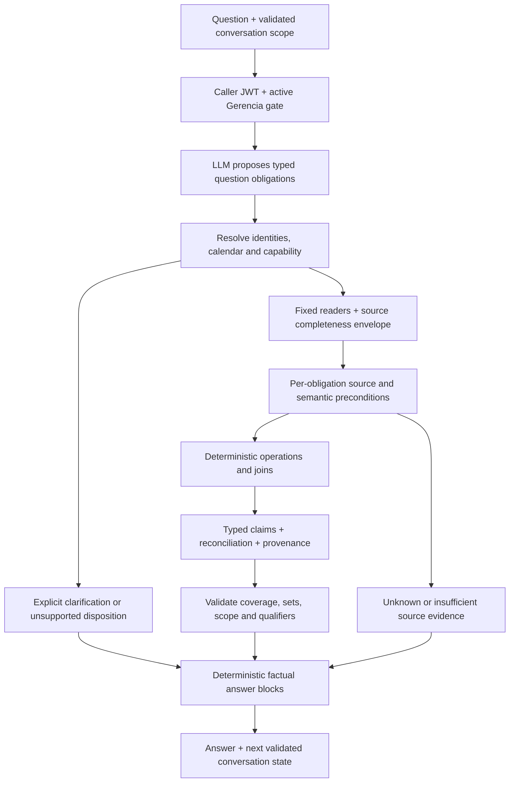

# Esco 2.0 recovery: repair the contracts before expanding the product

**Status: P0–P1 approved by Santiago on 2026-11-04; P2–P6 remain proposed.** Date: 2026-11-04, America/New_York.
Technical lead: Codex/Astra, with separate CTO and adversarial QA reviews.
Approval permits P0 contracts and the P1 isolated offline prototype/test comparison only.
It does not authorize later implementation, paid campaigns, production reads, migration,
deployment, release, commit or push. The master plan v0.4 incorporates this recovery path;
existing tracker rows remain authoritative. Earlier approval requests below are retained
as the proposal's rationale; P0–P1 are now approved and execution belongs to the fresh Sol session.

## Recommendation

Esco 2.0 has structural weaknesses, but the evidence does not justify throwing it away.
Keep the closed-operation, deterministic-calculation, caller-JWT architecture. Redesign the
contracts between source availability, question intent, computed evidence and the answer.
First compare a bounded repair with a thin version of those contracts on fresh synthetic
tests. Do not add the remaining domains until that experiment establishes a reliable pattern.

The central problem is that a valid aggregation and a bag of supported numbers do not prove
that the system answered the user's question. Today it can validate the syntax of a plan,
execute that plan correctly, and publish a semantically false answer. Some questions cannot
even be represented by the plan. Better prompts or a stronger model cannot repair those
representation limits. Conversely, the missing four-domain implementation and incomplete
evaluation inputs are not proof that the execution architecture itself is wrong.

The smallest defensible recovery is **a narrow contract/orchestration redesign**, starting
with labor and its application association. Use authoritative deterministic answer blocks
before reconsidering free-form composition. Keep the language model for interpretation;
do not build a general agent framework, unrestricted SQL tool or agent per domain.

## Evidence boundary and baseline

- Started with clean `main` at `9dfd46d919546f845270c084615fcfea12873e97`; local
  `origin/main` matched. A read-only Composio GitHub branch lookup independently confirmed
  that remote tip during this review. No checkout reset or branch switch was used.
- Read the [handoff](handoff-2026-11-04-astra.md), [D31 report](d31-result-2026-11-04.md),
  root `CLAUDE.md`, M2/M3/M4 and domain reports, current source and synthetic tests.
  Also read the [PRD](https://www.notion.so/40d67755ed68803e8c37e928d0b31860),
  [master plan](https://www.notion.so/40d67755ed6881dba866f9775fca997e), and tracker.
  Older tracker completion labels do not override D31. D32 already resolves the
  conductivity rule; the older M1 document's decision-pending label is stale.
- D17 remained intact: no held-out directory, sheet, evaluator sessions, raw answers,
  reference values or private artifacts were opened. No per-case material is reproduced.
  No new production reads or paid model calls occurred. Only this planning file changes.
- The 7,190-test/build/typecheck/lint baseline is inherited publication evidence. This
  review independently reran **124 synthetic tests across five files**, all passing,
  and reproduced deterministic defects with in-memory synthetic Node assertions.
  These checks do not certify functional acceptance, deployment or live data completeness.
- Bot Log BL-64 records successful publication CI/Vercel after dispatch. This review
  verified the remote commit, not a fresh deployment or CI execution.

### What D31 establishes, and what it cannot establish

| Observation | Defensible conclusion | Invalid inference |
|---|---|---|
| 50 scenarios, 300 attempts, 26 full-rubric passes, 23 critical attempts | Acceptance failed for the measured five-domain scope | 300 independent questions, or 23 distinct defect causes |
| 208 pure unsupported refusals | Major product coverage failure | A safe refusal is an accepted in-scope answer |
| Labor passes: Luna 9/30, Sol 16/30; critical attempts 8 and 9 | Supported-family quality is also inadequate | All failures come from missing domains |
| Historical execution contains only 10 labor scenarios | Only the labor subset has a historical pairing | Full-set before/after improvement |
| Historical snapshot lacks scheduling/real-date and association fields | Reference answerability and execution-source answerability differ | All errors are model errors, or a live reader would necessarily pass |
| Automatic scorer versions differ | Numerical before/after scores are descriptive | Same-scorer causal improvement |

The repeats measure stability on the same scenarios. D31's aggregate categories do not let
us allocate each critical failure to a specific source defect. The failures below are
independently reproducible mechanisms; their contribution to D31 remains unquantified.

## Diagnosis from current source

Line references below refer to the baseline above. Core filenames refer to
[`src/utils/esco2/`](../../src/utils/esco2/); test filenames refer to
[`src/__tests__/`](../../src/__tests__/); `manejador.ts` and `index.ts` refer to
[`supabase/functions/esco-consultas/`](../../supabase/functions/esco-consultas/).
Paths are public tracked source.

| Finding | Classification and evidence | Required response |
|---|---|---|
| Missing application data becomes an empty list | **Confirmed defect.** `fuente.ts:27–31` converts omitted `aplicaciones` to `[]`, despite `tipos.ts` defining omitted as unread. `ejecutor.ts:263–265` emits null; `nucleo.ts:124` says no association. Direct executor and adapter-mediated execution differ. | Preserve unavailable versus verified-empty end to end; test the adapter boundary, not only the executor. |
| Numeric membership is mistaken for claim support | **Structural.** `guardaNumerica.ts:11–45` pools all result values, today and the question. Lines 48–69 compare magnitudes; 89–115 check required values anywhere in the answer. `nucleo.ts:242–245` publishes on that basis. | Bind value, metric, unit, entity, period and qualifier. User-supplied numbers cannot become factual evidence. |
| Work records and scheduled tasks share one query meaning | **Structural.** `ejecutor.ts:97–155` clips the period to today and filters `fecha_trabajo`; task dates are metadata at 253–261. `registro.ts:65–71` nevertheless advertises planned-task questions. | Separate recorded-work and scheduled-task cohorts/date bases. Attaching dates does not implement scheduling selection. |
| Tasks without matching work enter a lot-scoped result | **Confirmed scope ambiguity.** `ejecutor.ts:193–199` inserts tasks using task/category filters only. A synthetic task with work only in another lot appears in the named lot's result with state/estimate and `ok`. | Prove lot membership or mark global task metadata separately. Do not infer assignment from an absence of work. |
| Ranking cannot express the requested metric | **Incomplete semantic contract.** `registro.ts:73` and `ejecutor.ts:270–272` define top-N only by jornales. No sort metric/direction or explicit business tie rule exists. | Explicit supported ranking semantics; no model-side re-ranking or invented calculations. |
| Mixed intentions can disappear | **Structural product limitation, currently intentional precedence.** `registro.ts:175–188` makes clarification or unsupported win over other calls. `esco2Nucleo.test.ts:165` locks in that behavior. | Track every requested obligation and its disposition. A dependent clarification may block execution; it must not erase the other obligations. |
| Entity resolution changes with catalog contents | **Structural risk.** `catalogo.ts:92–108` prefers task-name matches, otherwise task type. `prompts.ts:32` describes broader name-or-type matching. | Resolve task/type/category explicitly, then use stable IDs; preserve D26's business ambiguity rule. |
| Follow-up state is inferred from prose | **Structural risk.** `ambiguedad.ts:40–43,81` treats a marker in the last assistant message as a completed clarification. `prompts.ts:26` asks the model to inherit scope. | Typed pending clarification and accepted scope; validate the reply, do not assume that asking means it was answered. |
| Source completeness is narrower than its name implies | **Unproven completeness.** `fuente.ts:73–99` verifies row counts; 185–195 reads catalog tables independently, followed later by work records. Equal counts cannot prove snapshot consistency, unique membership, field availability or complete visible associations. | Declare guarantees and limitations per source/operation. Use consistent reads only where the claim needs them. |
| Test oracle and production guard are weaker than the rubric | **Validation gap.** `evaluacion.ts:102–139` checks numeric presence, not claim identity; `puntuarCaso:153–162` defaults to the first turn except D26. | Independent semantic oracle over all turns and required clauses; retain anchor checks as diagnostics. |

Two synthetic answer mutations passed both numeric guards in the lead's independent probe:
swapping value/metric/entity assignments, and adding a number supported only by the question.
The probe also reproduced unknown-to-absent conversion and unproven lot membership. No
private example was needed. The existing omitted-fields test (`esco2M4Labores.test.ts:92`)
calls the executor directly, which explains why it misses the memory-adapter conversion.

The deterministic fallback is useful but is not a semantic certificate. It inherits source
errors, uses model-provided `proposito` as a heading (`nucleo.ts:96`), and does not render every
coverage qualification, including top-N truncation. A safe recovery must validate results
and generate scope labels in code before making the fallback the primary answer.

### What should survive

- Fixed-column, read-only readers; closed registry; rejected unknown operations/arguments.
- Caller-JWT reads, active-Gerencia gate, gateway JWT verification, and legacy/Telegram
  isolation (`manejador.ts:105–116,155–170`; `index.ts`; isolation tests).
- Pure calculations, explicit sin-lote groups, null-cost propagation, unresolved-name
  failure, and shared TypeScript source across tests and function.
- Injected Bogotá calendar date and pure calendar arithmetic. ISO validity is already
  enforced; interpretation of a relative period still needs a semantic contract.
- Exact-count pagination as one useful check, bounded calls and model usage receipts.
- D26 clarification policy and D30 separately labeled whole-task estimates. Change their
  representation, not Santiago's decisions. Explicitly document the cohort for estimates.
- Existing domain calculators where their own contracts support reuse. Avoid copying UI
  hooks that silently supply current dates or wrong cohorts.

### What remains incomplete or uncertain

| Domain | Current position | Dependency before an accepted capability |
|---|---|---|
| Labor | One implemented aggregation operation with metadata extensions | Source/intent/claim contracts, scheduling cohort, ranking, reconciliation and follow-ups |
| Applications | Association metadata only; not an applications operation | Identity-based joins; planned versus executed quantities; approved valuation basis |
| Monitoring and conductivity | No registered query operation | Rounds and coverage semantics; reuse approved engines; apply D32, not the stale pending label |
| Observed weather | No registered query operation | Daily summary reader, quality/missing-day semantics, explicit dry-spell threshold/date convention |
| Dairy herd | No registered query operation | Animal ID identity; existing reproductive engine; explicit current versus historical state; missing weights remain unknown |

M1 contains useful development-source work, not acceptance of these four missing operations.
Current-state rows do not become historical state merely by filtering `created_at`. A future
historical answer needs event reconstruction or an explicit unsupported-history disposition.
Production field completeness, read consistency under concurrent edits, real language-to-intent
reliability and recovery UX remain unmeasured here. Existing module calculators deserve
operation-specific audits before reuse; this review did not certify each domain engine.

## Alternatives and decision

| Option | Benefit | Cost and limitation | Verdict |
|---|---|---|---|
| A. Bounded repair | Fix adapter/cohort defects; retain existing result objects and add complete deterministic rendering, capability checks and required qualifiers | May need less new machinery than B. Existing structures may still be insufficient for scheduling, multipart and follow-up semantics; the experiment must establish that limit. | A serious competing option. If it passes the shared obligations with less complexity, choose it. Narrow product scope only by explicit decision, not to improve its score. |
| B. Thin contract/orchestration redesign | Makes source readiness, question obligations and factual support testable while retaining security and calculations | Requires typed results, renderer and planner changes; can become overbuilt if generalized too early | **Recommended**, with an early stop/go experiment and a labor/application slice. |
| C. Broader replacement | Could simplify a truly incompatible execution model | Recreates readers, access controls, domain rules and evaluation; adds migration risk without evidence of a framework bottleneck | Defer. Revisit only if B cannot represent approved essential tasks without an unrestricted interpreter or excessive special cases. |

Calling typed schemas a repair rather than a redesign does not change the decision. The
boundary is whether semantic obligations and claim support become explicit. Do not rewrite
good arithmetic to make the refactor look comprehensive. No new framework, database or
provider is needed for the proposed experiment.

## Proposed contracts and flow

**1. Source envelope.** Each reader supplies schema/reader version, dataset identity,
capture time, effective date basis, authorized visibility scope, requested/available fields,
row and pagination completeness, relation completeness, exclusions, and consistency mode.
Every relevant value/relation distinguishes known value, recorded null, unread/unavailable,
and verified empty. Verified empty is only within a demonstrably complete authorized scope;
RLS-hidden data must not be described as nonexistent globally. A failed count or required
field returns a typed source failure before factual composition.

The snapshot adapter and live adapter implement the same guarantees; test conformance with
identical synthetic data. Per-field availability cannot be inferred from one optional date
column. A capture timestamp is provenance, not proof of a transaction snapshot. For strict
cross-table reconciliation, assess a fixed INVOKER read transaction/RPC in a later approved
block; never solve consistency with service-role access. The experiment needs no migration.

**2. Intent contract.** Each question obligation has a domain/capability, entity kind and
resolved IDs, cohort, date basis and interval, metric/unit, grouping grain, order/direction,
ties, exclusions, join key, required answer fields and disposition. Separate work-date
aggregation from scheduled-task selection and current task status. Preserve the original
phrase as diagnostic context, not executable authority. Generate ordinary relative periods
with shared calendar functions after interpreting the period kind. Reject unrepresentable
semantics or clarify them instead of selecting the nearest available operation.

Each obligation ends as answered, needs clarification, source unavailable, unsupported or
error. A partial response explicitly names what remains; it is never a full-rubric pass.
This contract does not prove that the LLM captured every requested obligation. Independent
language-to-intent evaluation remains necessary; do not hide that problem behind a second
LLM that agrees with the first.

**3. Semantic evidence contract.** A claim binds operation/obligation ID, stable entity and
cohort, metric, unit, date basis/period, value status, value or exact member set, provenance,
and mandatory qualifiers. Rankings carry the selected metric, tie policy, total population
and omitted remainder. Reconciliation states which disjoint parts sum to the total, the
excluded/missing parts, and when nulls prevent equality. Ratios carry numerator/denominator
scope and time basis. Estimated and registered work remain separate claims under D30;
partial known estimates must not be presented as a complete zero or complete total.

**4. Answer contract.** Generate factual text, names, scope headings, tables, missing-data
statements and qualifiers from validated claims. Check required claim IDs and set equality,
not numbers appearing anywhere. Keep the numeric guard as a secondary smoke check only.
Initially omit the LLM composer. If prose flexibility later proves valuable, let the model
choose validated presentation blocks or claim IDs, with code filling facts and labels.
Arbitrary model-written prose is not certified by attaching claim IDs to it.

**5. Conversation contract.** Carry the last accepted typed scope and a typed pending
clarification with alternatives and an expiry/version. Resolve the reply against those
alternatives; unrelated replies cannot silently authorize a choice. Bind any authoritative
state to the authenticated caller. For the offline experiment, inject state; for deployment,
choose signed stateless state or an owner-RLS store before implementation. User-supplied
history remains untrusted context and never grants permissions. Reset on user change.

## Small discriminating experiment, before a larger implementation

**Proposed scope: 2–3 engineer-days plus 1 QA-day; zero paid calls or production reads.**
This is the next block to approve, not work performed by this planning assignment.

QA authors and freezes **16 fresh synthetic scenarios** from the contracts, without private
references: four source-state/association/cohort scenarios; four calendar, grouping and
ranking scenarios; four answer binding/set/reconciliation scenarios; and four multipart,
ambiguity and follow-up scenarios. Include complete and deliberately incomplete variants
where relevant, equal-valued metrics, zero/null, duplicate labels with distinct IDs,
top-N/ties, and explicit unknown outcomes. Do not choose only cases the current DSL supports.

Compare three variants on the same inputs and independent expectations:

1. Current baseline, to expose the known holes.
2. Bounded repair: minimal adapter/cohort fixes, existing result structure, complete
   deterministic rendering and capability checks. Remove free-form factual composition
   here too, so B does not win merely by receiving a safer renderer.
3. Thin contract slice: source envelope, two cohort meanings, claim-bound deterministic
   rendering and explicit follow-up/obligation state. Reuse calculations and fixture readers.

All variants face the same predeclared required capability slice, including calendar,
ranking, multipart and follow-up behavior. A may add the minimum operation fixes needed for
that slice; it is not constrained to fail on capabilities B receives. Track the resulting
scope and effort rather than moving those scenarios out of A's denominator.

Run (a) approved intent to execution, (b) approved results to answer validation, then
(c) scripted planner outputs through the real handler/orchestration with the synthetic RLS
harness. QA uses an independent SQL/table oracle, not expected values computed by the same
executor. Inject mutations: wrong entity, unit, date basis, set member, absent qualifier,
unsupported question number, skipped obligation and unknown-to-empty conversion. Each must
fail at the intended boundary. A positive control must pass, so rejecting everything cannot win.

**Exit gate:** all 16 scenarios' semantic obligations and source-state expectations pass;
zero critical false assertions; every predefined mutation is detected; no permission/isolation
regression. Every supported, source-complete scenario must receive its substantive answer.
Clarification, unknown and unsupported outcomes pass only where the independent oracle
predeclares them. Report failures by boundary, not just a suite percentage. Measure code touched,
special cases, serialized payload size and deterministic latency on identical inputs.

**Falsification:** if A satisfies the same obligations and mutations with fewer moving parts,
choose A and stop expanding the design. If B merely relocates ambiguity or needs a generic
query language to handle this slice, stop and revise the representation. If both pass, prefer
the smaller maintainable implementation. If correct typed plans still fail, fix execution;
if typed plans pass but later real-language trials fail, target interpretation rather than
rewriting the executor. This experiment cannot establish natural-language accuracy or product
acceptance. A separately approved, budgeted model trial comes only after its gate.

## Prioritized implementation blocks, dependencies and gates

Estimates are planning ranges, not commitments. Assume one experienced TypeScript implementer,
separate QA, prompt access to Santiago for domain decisions, and reuse of current calculators.
One engineer-day means about six focused hours. External approval and data remediation time
are excluded. QA effort is additional, not hidden in the implementation estimate.

| Block | Deliverable / owner | Depends on | Effort | Exit gate |
|---|---|---|---|---|
| P0. Freeze semantics | CTO/CPO: essential capability list, source field matrix, date/cohort/valuation rules, experiment rubric | Santiago approves the next block and keeps D17 | 1–2 engineering days + owner review | No undefined essential-task semantics; unavailable data recorded explicitly |
| P1. Discriminate | Backend prototype and independent QA experiment above; bounded A/B comparison | P0 | 2–3 engineering + 1 QA day | Synthetic exit gate; written decision to repair, redesign or stop |
| P2. Recover labor slice | Backend: adapter conformance, explicit cohorts/IDs/ranking, claims, renderer, follow-up; QA: boundary and mutation suites | P1 supports chosen design | 4–7 engineering + 2–3 QA days | All labor essentials on development evidence; no critical assertions; read-state parity |
| P3. Applications and labor join | Backend/domain owner: application operation, identity joins, quantities, plan/execution and valuation qualifiers | P2 contracts + approved source semantics | 4–7 engineering + 2–3 QA days | No text joins/double counts; reconciliation and valuation oracles pass |
| P4. Remaining three domains | Separate monitoring, weather and dairy capabilities; reuse audited engines | P2 stable; each domain's matrix/oracle ready | 3–5 engineering + 1–2 QA days per domain | Per-domain essentials, missing-data behavior and cross-domain relation tests pass |
| P5. Independent acceptance | Independent evaluator: source-complete frozen input, references, all-turn semantic rubric, stability and model comparison | Relevant P2–P4 capabilities + separate data/model authorization | 2–4 engineering/support + 2–4 evaluator days | PRD threshold, essentials, no critical failures; inconclusive references prevent closure |
| P6. Isolated pilot readiness | Backend/frontend/QA: budgets, deadlines, safe diagnostics, ownership, real JWT/role and UI checks, release/rollback rehearsal | P5 + separate migration/deploy/pilot approvals | 2–4 engineering + 1–2 QA days | Access, spend, latency and rollback gates signed off |

These blocks total roughly **24–42 engineering days plus 11–19 QA/evaluator days** for the
five-domain recovery, before waiting time. This is a low-confidence scope estimate, not a
promise that all domains need equal work. Re-estimate after P1; do not authorize the total
from this table. A labor/application internal milestone can precede P4, but cannot be labeled
five-domain acceptance. One PR per approved block or smaller reviewable task, from then-current
main; avoid several parallel edits to the same contracts.

### Validation and source acceptance

- **Mechanism gate:** existing focused tests remain green, plus independent conformance and
  mutation tests. Relevant current command:
  `npm test -- src/__tests__/esco2Nucleo.test.ts src/__tests__/esco2M3Planificador.test.ts src/__tests__/esco2M4Labores.test.ts src/__tests__/esco2LaborReview.test.ts src/__tests__/esco2EscoConsultas.test.ts`.
  Future implementation also runs `npm run typecheck`, `npm run lint`, production build and
  diagnostic pruning checks. Create an explicit offline semantic-contract test command in P1.
  Do not run `scripts/esco2/e2e-local.ts` as an offline check: it calls OpenRouter and prints
  some mismatches rather than making every mismatch a failing assertion.
- **Source gate:** independent reader/reference manifest maps every essential operation to
  fields, relation keys, time semantics, visible population and completeness. Derive execution
  data from authorized source tables, never from the expected answer. A missing field blocks
  that claim even when the independent reference knows the answer.
- **Evaluation gate:** freeze code, source manifest, scenarios, references, rubric and
  answerable denominator before running. Keep D31 inputs/results immutable. If execution
  data need enrichment, create a separately versioned source-complete track and report it
  separately from the unchanged historical-snapshot regression track. Do not enrich the old
  snapshot in place or claim an apples-to-apples score increase. Independent reference
  corrections require documented authority and uniform re-evaluation, never implementer tuning.
- **Product gate:** at least 90% complete/correct among the fixed answerable denominator in
  development and held-out; every predeclared domain essential passes; zero observed critical
  failures, including false factual claims and security breaches. Expected clarifications and
  missing-data behavior have separate frozen oracles. Unsupported product questions stay in
  the denominator. Report sample size, scenario-level confidence intervals, every repetition,
  and per-domain/route/complexity results. Do not count repeats as independent scenarios.
- **Independence gate:** D31 authorized reuse of the same 50 through an independent evaluator;
  it did not give implementers access. Aggregate-guided repair still adapts to that test.
  A fresh sealed generalization set is a later decision for Santiago, not an automatic
  replacement of D31 or a reason to discard unfavorable cases.

## Cost, latency and maintenance

D31 observed USD 0.494003265 for 403 calls, including 208 pure unsupported attempts. The
mixed-domain p90s (5.24s Luna, 7.48s Sol first-turn) are not a useful pilot SLA: refusals make
that mix easier. Labor first-turn p90 was 6.28s and 8.78s. Neither aggregate predicts the
proposed design's performance or establishes that the larger model is the remedy.

The experiment has **USD 0 provider budget**. A later trial needs an explicit new hard cap,
call/token reservations, fail-closed unknown costs, and stop conditions; unused historical
allowance is not permission. Measure total spend divided by complete accepted questions,
including failures, clarification and retries. Report accepted substantive latency separately
from refusals, all-turn latency, source time and per-stage time. Freeze numeric pilot limits
with Santiago after that measurement, as the PRD requires.

Removing free-form composition may eliminate one or two calls, but savings and quality are
hypotheses until measured. The current call-count cap does not bound dollars or elapsed time:
catalogs can grow, and `llm.ts` has no explicit request timeout. P6 must add input/output and
row limits, wall-clock aborts, per-user rate/spend caps and a global circuit breaker before
pilot exposure. Preserve unknown usage as unknown; the current log sum in
`manejador.ts:183` substitutes zero for null and is not reliable billing evidence.

Maintenance should follow a repeatable capability template: reader/schema, preconditions,
pure operation, typed claims, renderer, independent oracle and capability manifest. Version
these together. Record sanitized stage/error/coverage IDs and requested/served model where
available; keep raw business payloads and identities out of public diagnostics. Use fixed
error codes instead of assuming truncated provider/database error strings are safe logs.

## Isolation, rollback and decisions

Keep legacy web chat and Telegram field capture unchanged. The local diagnostic remains
development-only. Keep the v2 deployed route isolated until explicit release approval;
do not connect production chat as part of a contract refactor. Version new contracts alongside
the old adapter during the experiment, then remove superseded paths after acceptance rather
than maintaining permanent duplicate engines. No new runtime dependency is proposed.

For a later pilot, route explicitly to the accepted version and preserve a tested disable
switch. Rollback means disabling new consultation traffic and retaining field capture; it
must not silently route failed queries to an unaccepted legacy answer path. Preserve logs and
data. Verify a rollback artifact from a clean revision before release. Applied migrations are
never edited or casually reversed. Migration 190 remains a separate authorization/ledger check;
this review neither applied it nor inferred its live state.

**Decisions Santiago needs to make, in order:**

1. Approve P0–P1 only: a source/semantic contract and offline comparison, with no paid calls,
   production reads or deployment. Confirm deterministic factual blocks are acceptable for
   the first recovered slice. This is the recommended immediate decision.
2. Confirm the essential labor/application tasks and unresolved semantics: scheduled-task lot
   membership, status as-of versus current, estimate cohort, ranking/ties and application
   valuation labels. CPO/domain owners prepare bounded choices; do not ask Santiago to design types.
3. After P1, choose the winning repair/design and authorize P2 scope. Decide whether an early
   milestone stays labor/application-only while all five domains remain the phase-1 commitment.
4. Before P5/P6, approve source acquisition if needed, the independent evaluator/campaign cap,
   treatment of any new sealed set, measured pilot limits, and deployment/migration separately.

**Standalone next step:** Santiago reviews this proposal and approves or rejects P0–P1:
freeze the source/semantic requirements and compare bounded repair against a thin contract
prototype on 16 fresh synthetic scenarios, offline, with independent QA and zero model spend.
